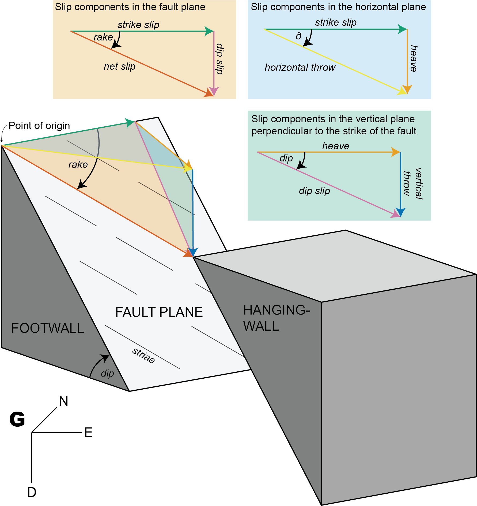

# Fault Offsets

This tutorial demonstrates how you can derive displacement components
from fault slip.

The offset along a fault can be factorized into several components
([Figure 1](#fig-displacements)).



Figure 1: Graphic illustration of displacement components along a fault.
$`\mathbb{G}`$ is the geographic reference frame with D = Down, E =
East, N = North.

## Get different components with trigonometry

### Fault orientation (dip angle, dip direction), shortening direction, and horizontal throw

Knowing the horizontal throw (e.g. from plate motion parameters), the
remaining components of the displacements along a given fault are as
follows. The angle $`\delta`$ between the direction of horizontal
displacement (here assumed parallel to $`e_3`$) and the fault strike is

``` math
\delta = |e_3 - (\text{dip direction} + 90^{\circ})|
```

*Slip components in the horizontal plane:*

``` math
\begin{aligned}
  f_\text{strike slip} &= |\cos{\delta} \cdot f_\text{horizontal throw}|\\
  f_\text{heave} &= \sqrt{f_\text{horizontal throw}^2 - f_\text{strike slip}^2}
\end{aligned}
```

*Slip components in the vertical plane perpendicular to the strike of
the fault:*

``` math
\begin{aligned}
  f_\text{dip slip} &= \frac{f_\text{heave}}{\cos{(\text{dip})}}\\
  f_\text{vertical throw} &= \sqrt{f_\text{dip slip}^2 - f_\text{heave}^2}
\end{aligned}
```

*Slip components in the fault plane:*

``` math
\begin{aligned}
  f_\text{net slip} &= \sqrt{f_\text{strike slip}^2 + f_\text{dip slip}^2}\\
  \text{rake} &= \arctan{\left(\frac{f_\text{dip slip}}{f_\text{strike slip}}\right)}
\end{aligned}
```

Thus, the rake angle describes the ratio between the dip slip and the
strike slip component.

Knowing the vertical throw (e.g. from thermochronology or petrology),
the (assumed) fault dip, and the direction and amount of horizontal
offset, the **strike** of the fault is as follows:

``` math
\begin{aligned}
  f_\text{heave} &= \frac{f_\text{vertical throw}}{\tan{(\text{dip})}}\\
  \delta &= \arcsin{\left(\frac{f_\text{heave}}{f_\text{horizontal throw}}\right)}\\
  \text{strike} &= |e_3 - \delta|
\end{aligned}
```

Knowing the vertical throw (e.g. from thermochronology or petrology),
the fault strike (e.g. from geomorphology), and the direction and amount
of horizontal offset, the **dip** of the fault is as follows:

``` math
\begin{aligned}
  \delta &= |e_\text{3} - \text{strike}|\\
  f_\text{heave} &= f_\text{horizontal throw} \cdot \sin{\delta}\\
  \text{dip} &= \arctan{\left(\frac{f_\text{vertical throw}}{f_\text{heave}}\right)}
\end{aligned}
```

Knowing the vertical throw (e.g. from thermochronology or petrology) and
the fault’s dip and rake, the heave, the strike slip, the horizontal
throw, and the net slip are as follows:

``` math
\begin{aligned}
  f_\text{dip slip} &= \frac{f_\text{vertical throw}}{\sin{(\text{dip})}}\\
  f_\text{heave} &= \frac{f_\text{vertical throw}}{\tan{(\text{dip})}}\\
  f_\text{strike slip} &= \frac{f_\text{dip slip}}{\tan{(\text{rake})}}\\
  f_\text{horizontal throw} &= \sqrt{f_\text{strike slip}^2 + f_\text{heave}^2}\\
  f_\text{net slip} &= \frac{f_\text{dip slip}}{\sin{(\text{rake})}}
\end{aligned}
```

## Fault displacement tensors

Each fault component is a vector describing its direction and length.
For instance, the vector of the strike slip is:

``` math
\vec{f}_\text{strike slip} = \begin{pmatrix} \lVert f_\text{strike slip}\rVert \\ 0 \\ 0 \end{pmatrix}
```

## Net slip vector

The net slip vector is the sum of the strike slip, heave, and vertical
throw vectors:

``` math
\vec{f}_\text{net} = \begin{pmatrix} \lVert f_\text{strike slip}\rVert \\ \lVert f_\text{heave}\rVert \\ \lVert f_\text{vertical throw}\rVert \end{pmatrix}
```

``` r

fault_displacements(strikeslip = 2, verticalthrow = -5, heave = 3)
```

## Principal displacement tensor

The eigenvalues of $`\mathsf{F}_{ij}`$ are the magnitudes of the heave,
strike slip, and vertical throw components, and the corresponding
eigenvectors $`\{ \vec{f}_1, \vec{f}_2, \vec{f}_3 \}`$ are mutually
orthogonal unit vectors along these directions. In this principal frame
the tensor is diagonal, i.e. the **principal displacement tensor**
$`\mathsf{F}_\mathbb{F}`$:

``` math
\mathsf{F}_{\mathbb{F}} = \begin{bmatrix} \lVert f_\text{heave}\rVert & 0 & 0\\ 0 & \lVert f_\text{strike slip}\rVert & 0\\ 0 & 0 & \lVert f_\text{vertical throw}\rVert\end{bmatrix}
```

The tensor $`\mathsf{F}`$ can also be defined by the magnitudes of the
fault displacements:

``` r

Fu <- displacement_tensor(s = 2, v = -5, h = 3)
print(Fu)
```

         [,1] [,2] [,3]
    [1,]    3    0    0
    [2,]    0    2    0
    [3,]    0    0   -5
    attr(,"class")
    [1] "matrix"  "array"   "ftensor"

## Orientation tensor

The fault orientation tensor is defined by the fault plane’s orientation
(dip direction and dip angle) and the fault’s slip (direction and
magnitude):

``` math
\mathsf{F}_{ij} = \begin{bmatrix}f_{11} & f_{12} & f_{13}\\ f_{21} & f_{22} & f_{23}\\ f_{31} & f_{32} & f_{33}\end{bmatrix}
```

``` r

Fg <- displacement_tensor(s = 2, v = -5, h = 3, dip_direction = 45)
print(Fg)
```

            [,1]      [,2] [,3]
    [1,] 2.12132  1.414214    0
    [2,] 2.12132 -1.414214    0
    [3,] 0.00000  0.000000   -5
    attr(,"class")
    [1] "matrix"  "array"   "ftensor"

## From principal displacement tensor to orientation tensor

Translate the origin of $`\mathsf{F}_\mathbb{F}`$ to the point of
measurement and rotate it into the fault orientation, giving
$`\mathsf{F}_\mathbb{FG}`$:

``` r

displacement_tensor_decomposition(Fg, dip_direction = 45)
```

    $displacements
              dip    delta     rake verticalthrow horizontalthrow heave  dipslip
    [1,] 59.03624 56.30993 71.06818            -5        3.605551     3 5.830952
         strikeslip  netslip
    [1,]          2 6.164414

    $fault
    Fault object (n = 1):
    dip_direction           dip       azimuth        plunge         sense
         45.00000      59.03624     258.69007     -54.20424      -1.00000

    $strain_tensor
         [,1] [,2] [,3]
    [1,]  3.0 -1.5 -1.5
    [2,] -1.0  1.0 -1.0
    [3,]  2.5  2.5 15.0

    $volumetric_strain
    [1] 19

    $shear_strain
    [1] 5.196152
